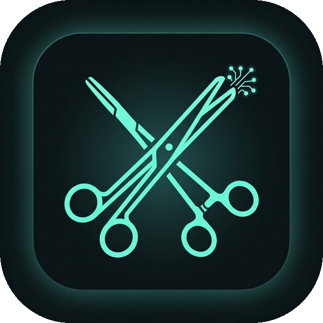
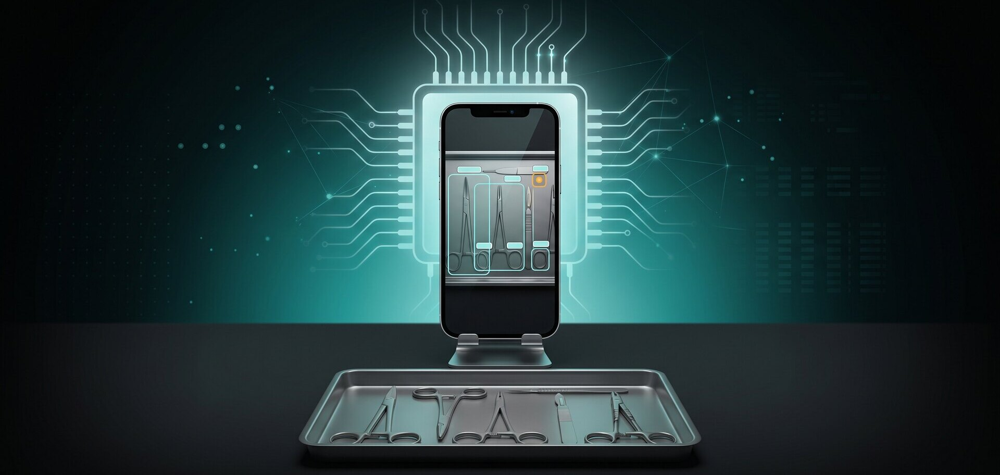

<p align="center">
  
</p>

<h1 align="center">Surgical instrument monitoring with on-device computer vision</h1>

<p align="center">
  Android (Kotlin) app that detects and tracks instruments on the surgical table,
  records removals and returns, and runs the final check — with inference exclusively on the phone's NPU.
</p>

<p align="center">
  <a href="README.md">Português</a> · <b>English</b>
</p>

<p align="center">
  <a href="LICENSE"></a>
  
  
  
  
  
  
</p>

<p align="center">
  
</p>

Android (Kotlin) app to prevent inadvertent retention of surgical instruments (RSI, retained surgical items). Computer vision runs entirely on the device: it detects and tracks instruments on the operating table, records removals and returns, and runs the final check on instruments that did not come back.

Inference runs on the Qualcomm Hexagon NPU (QNN HTP) with no CPU fallback: if the NPU does not accept the model, the app fails explicitly instead of running silently on the CPU. No image is sent to external servers: processing happens on the device, and the Wi-Fi stream, when enabled, is restricted to the local network.

Numbers measured on the bench with a POCO F7 over 5.4 minutes of continuous operation: 27.0 frames per second end to end and 34.7 ms average latency per frame (14.4 ms on the NPU).

**[How it works](#how-it-works) · [Target](#target) · [Model and quantization](#model-and-quantization) · [Wi-Fi streaming](#wi-fi-streaming) · [Repository structure](#repository-structure) · [Build and tests](#build-and-tests) · [Automated tests](#automated-tests) · [Limitations](#limitations) · [License](#license)**

## How it works

```
CameraX (ImageAnalysis 960×720, KEEP_ONLY_LATEST)
      │  frame → upright bitmap → letterbox 640×640 (aspect preserved, gray padding)
      ▼
Detector on the NPU (detector_int8.onnx, A16W8)
      │  outputs: boxes [1,4,8400] + scores [1,5,8400]
      ▼
Post-processing (Kotlin)
      │  highest score across the 5 classes → single class, confidence filter and NMS
      ▼
Tracker (Kotlin)
      │  global association, motion model and visual template
      │  temporal confirmation and lifecycle (removed / returned)
      ▼
Overlay (boxes), instrument list and final check
```

Tracking does not rely on a single frame. A candidate becomes a confirmed instrument only after appearing in 4 of the last 8 frames, with peak confidence ≥ 0.55, median ≥ 0.40 and 3 accumulated seconds at confidence ≥ 0.65. Low-confidence or missing frames subtract from that accumulated time, so an isolated spike confirms nothing. Short detections are dropped silently: they neither enter the list nor raise events.

### Single class

The raw model distinguishes five instruments (`clamp`, `needle_holder`, `scalpel`, `shear`, `tweezer`), but for retention prevention the subclass does not matter, and fine classification failed often (scissors vs. forceps, for instance). Post-processing collapses the five scores to the highest one and reports everything as "Surgical Instrument". The winning raw class is kept internally and used when associating detections across frames. NMS runs before the collapse, using each anchor's raw class, so two different instruments that overlap are not merged into one box.

### Thresholds

| Stage | Constant | Value |
|---|---|---|
| Detection per frame | `Postprocessor.CONFIDENCE_THRESHOLD` | 0.25 |
| NMS | `NMS_IOU_THRESHOLD` / `CROSS_CLASS_NMS_IOU_THRESHOLD` | 0.45 / 0.55 |
| New candidate | `MIN_NEW_DETECTION_CONFIDENCE` | 0.35 |
| Confirmation | `CONFIRM_HITS` / `CONFIRM_WINDOW` | 4 / 8 frames |
| Max misses in window | `MAX_MISS_RUN_IN_WINDOW` | 1 frame |
| Peak confidence | `MIN_PEAK_CONFIDENCE` | 0.55 |
| Median confidence | `MIN_MEDIAN_CONFIDENCE` | 0.40 |
| Sustained certainty | `HIGH_CONFIDENCE_THRESHOLD` / `MIN_HIGH_CONFIDENCE_DURATION_MS` | 0.65 / 3 s |
| Removal | `REMOVE_AFTER_MISSED_MS` / `MIN_ON_TABLE_MS_FOR_REMOVAL` | 1.2 s / 1.2 s |
| NPU self-test (startup) | `ModelSelfTest.MIN_CONFIDENCE` | 0.04 |

### Instrumentation

The app measures its own performance and writes to logcat:

| Tag | Content | Interval |
|---|---|---|
| `DetectStats` | fps and time per stage (decoding, pre-processing, inference, post-processing, tracking), detections per frame and peak confidence | 5 s |
| `StreamStats` | capture and publish fps, dropped frames, encode time and JPEG quality | 5 s |
| `Tracker` / `NpuLog` | instrument confirmation, removal and return events, plus NPU activation | per event |

The main screen has a panel that is hidden by default with the NPU activation log (library paths, backend selection, graph compilation or context loading, and the sanity check).

## Target

| Item | Value |
|---|---|
| Device | POCO F7 (Xiaomi `onyx`, model `25053PC47G`) |
| SoC | Snapdragon 8s Gen 4 (SM8735) |
| NPU | Qualcomm Hexagon HTP V73 |
| Android | 16 (HyperOS 3), `minSdk 31`, `targetSdk 34` |
| Runtime | ONNX Runtime Android + QNN EP (`com.microsoft.onnxruntime:onnxruntime-android-qnn:1.29.0`) |

## Model and quantization

- Base model: [joonhaim/surgical-tool-recognition-yolo26s](https://huggingface.co/joonhaim/surgical-tool-recognition-yolo26s) (YOLO26s), exported without NMS to `best_fixed.onnx`. The model derives from the Ultralytics YOLO family (AGPL-3.0), which is why this project adopts the same license.
- A16W8 quantization (16-bit activations, 8-bit weights), with a QDQ graph and MinMax calibration over real bench frames and reference images. The calibration set is built by `_build_calibration.py`.
- Calibration uses the same input geometry as inference: an asset calibrated with stretch lost confidence when run with letterbox (0.85 to 0.54 on a test image). The comparison is in `_benchmark_preprocess.py`.
- 4:3 letterbox input: the portrait frame (960×720 analysis, 720×960 upright) becomes centered 480×640 content, without distorting the aspect ratio. The previous stretch distorted up to 1.78× and left boxes with the wrong aspect.
- The QDQ graph is portable and compiled by QNN on the device itself on first run. The context is cached at `files/models/detector_int8_ctx.onnx`.
- Outputs are split into `boxes` and `scores` because, in a single `[1,9,8400]` tensor, boxes and scores were requantized with one scale (dominated by the boxes, around 640 px) and the confidences collapsed to zero.
- A16W8 instead of INT8: with 8-bit activations the class-head logits degraded (bias near -6, sums of 128 terms) and the QNN runtime diverged numerically.

## Wi-Fi streaming

With nothing installed on the other device: the phone runs an embedded HTTP server and any Android or iPhone on the same network opens the page in a browser.

1. Turn on the hotspot on the POCO F7.
2. Enable "Transmitir (Wi-Fi)" on the main screen.
3. On the other device, join the hotspot and open the displayed URL (for example, `http://192.168.43.1:8080`). Tap the status to show the QR code.

| Aspect | Implementation |
|---|---|
| Routes | `/` (page), `/stream` (MJPEG), `/frame.jpg` (latest frame) |
| Android/Chrome | Native MJPEG (`multipart/x-mixed-replace`) |
| iPhone/Safari | Does not support MJPEG, so the page detects iOS and polls `/frame.jpg` instead |
| Video | 960×720 (4:3), 30 fps target, JPEG quality 70 (drops to 50 under load) |
| Limits | Up to 4 MJPEG viewers. The app must stay in the foreground and there is no authentication (local network) |

Encoding runs on its own thread (`rsi-stream`, FOREGROUND priority), with old frames dropped so latency does not accumulate, and `TCP_NODELAY` on the sockets.

## Repository structure

```
android/app/src/main/java/com/rsiprevention/app/
├── MainActivity.kt                 # single screen: preview, overlay, list and final check
├── camera/                         # CameraX and frame conversion (reused bitmap)
├── detection/
│   ├── Preprocessor.kt             # bitmap → float32 NCHW tensor + model pixels
│   ├── InstrumentDetector.kt       # ONNX session, per-stage timing
│   ├── Postprocessor.kt            # filter, single class and NMS
│   ├── ModelSelfTest.kt            # NPU sanity check on startup
│   ├── Letterbox.kt                # frame ↔ model transform
│   └── Box.kt / BoxMath.kt / Detection.kt / DetectionFrame.kt / DetectionResult.kt / ModelFrame.kt
├── ort/                            # ORT and QNN: sessions, context cache, strict backend
├── tracking/                       # InstrumentTracker, TrackedInstrument, Appearance, InstrumentStatus
├── perf/PipelineStats.kt           # per-stage timings (DetectStats log)
├── stream/                         # HTTP server, JPEG encoding, latest-frame slot, QR
├── ui/                             # OverlayView and QR code dialog
└── vocabulary/InstrumentVocabulary.kt

android/app/src/test/               # 54 JVM tests
_build_calibration.py               # builds the calibration set in the app's geometry
_quantize_qnn.py                    # A16W8 quantization
_benchmark_preprocess.py            # compares stretch and letterbox
_fix_output_split.py                # splits boxes/scores and validates the asset
_test_*.jpg                         # detector validation images
docs/                               # README images (icon and banner)
README.md                           # documentation (Portuguese)
LICENSE                             # AGPL-3.0
```

## Build and tests

Requirements: JDK 17 or newer and the Android SDK (platform 34).

```bash
cd android
./gradlew testDebugUnitTest     # 54 JVM tests
./gradlew assembleDebug         # produces app/build/outputs/apk/debug/app-debug.apk
```

On Windows (PowerShell):

```powershell
$env:JAVA_HOME = "C:\Program Files\Android\Android Studio\jbr"
cd android
.\gradlew testDebugUnitTest
.\gradlew assembleDebug
```

## Device deploy

With "Install via USB" enabled in developer options, `adb install -r` works on the POCO F7 (HyperOS 3). Without it, HyperOS blocks the install with `INSTALL_FAILED_USER_RESTRICTED`, and the way in is to push the APK and install it manually:

```bash
adb install -r android/app/build/outputs/apk/debug/app-debug.apk

# manual alternative
adb push android/app/build/outputs/apk/debug/app-debug.apk /sdcard/Download/rsi-app.apk
```

The QNN context is rebuilt automatically on the first launch after the model changes, because the asset signature changes.

## Model calibration and validation

```bash
# 1) capture real bench frames (streaming on, monitoring off)
adb forward tcp:18080 tcp:8080
for i in $(seq 1 70)
do
  curl -s -o frames/frame_$i.jpg http://127.0.0.1:18080/frame.jpg
  sleep 0.3
done

# 2) build the calibration set in the app's geometry
python _build_calibration.py --mode letterbox --frames frames/ --frames-stride 3 \
    --frames-aspect 3:4 --out calib.h5

# 3) quantize and validate on CPU
python _quantize_qnn.py --activations int16 --calib calib.h5 \
    --out models/_qnn_quant/letterbox_final --preprocess letterbox

# 4) install the assets and revalidate the bytes that go into the APK
cp models/_qnn_quant/letterbox_final/best_qnn_split.onnx android/app/src/main/assets/models/detector_int8.onnx
cp models/_qnn_quant/letterbox_final/model.data android/app/src/main/assets/models/model.data
python _fix_output_split.py --check --preprocess letterbox
```

## Automated tests

54 JVM tests, no device needed:

| Suite | Tests | Covers |
|---|---|---|
| `InstrumentTrackerTest` | 13 | short and persistent false positives, sustained certainty, identity after occlusion, class flips without duplication, silent discard, removal, final check, degenerate boxes, event timestamps |
| `PostprocessorTest` | 9 | confidence filter, single class, NMS per raw class, 640×640 clamping, peak confidence in the same pass, `rawClassId` |
| `AppearanceTest` | 5 | extraction in model space, similarity across regions, box partially outside the frame |
| `LetterboxTest` | 5 | portrait and landscape scaling, centered padding, frame ↔ model conversion |
| `PipelineStatsTest` | 5 | per-stage averages, interval fps, window restart |
| `LatestFrameSlotTest`, `StreamQualityControllerTest`, `HttpAndMjpegTest`, `HotspotAddressTest` | 17 | stale frame dropping, adaptive JPEG quality, HTTP parser, MJPEG format, hotspot IP |

## Limitations

- The app requires the Hexagon NPU. On another device or SoC the model may fail to compile, since the QNN context is SoC-specific and the quantization was validated on V73.
- Validation was done on the bench, with no real surgical setting and no ground-truth annotations on the frames, so there is no precision, recall or mAP. Performance is described by confidence metrics and tracking behaviour.
- Occlusions and momentary detection losses can interrupt an instrument's tracking for a few seconds.
- Instruments outside the five training classes, such as retractors, can produce partial boxes with a risk of duplicate records for the same object.
- No energy or temperature measurements were taken. The NPU's energy advantage over server GPUs is an argument from the literature and from the local architecture, not a measured result here.
- The app does not distinguish instrument types, by design.

## Reproducibility

- Embedded model (SHA-256 check):
  - `detector_int8.onnx`: `eb023290ff7848a3f63e9b7ac2c4fa4ed97d01a0b63e1ccc02667d0e23f8a855`
  - `model.data`: `b31541b23071f95291993d255bdc7778a329925f78d74d2f4bb791b076d00ae4`
- Quick CPU validation of the asset: `python _fix_output_split.py --check --preprocess letterbox`.
- Capture frames and raw performance logs stay out of the repository. The quantized model and the reference images are versioned.

## License

AGPL-3.0. Free to use, modify and redistribute, including network use, as long as the source code of the distributed or hosted version remains available under the same license. See [`LICENSE`](LICENSE).

## Notice

Research prototype. It is not a regulated medical device and does not replace manual instrument counting or patient safety protocols. Clinical use depends on prospective validation approved by an Ethics Committee.
